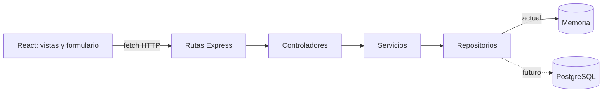

# Sistema de Información: Veterinaria Chiloé

Aplicación web para gestionar pacientes y fichas clínicas veterinarias. El frontend está construido con React y Vite; el backend expone una API REST con Express y mantiene los datos en memoria.

Proyecto de la asignatura Tecnologías Web y Móviles de Ingeniería Civil en Informática, Universidad de Los Lagos.

## Stack Tecnológico

- Frontend: React, Vite y CSS.
- Backend: Node.js, Express y CORS.
- Persistencia actual: memoria del servidor. El repositorio es el punto de sustitución futura por PostgreSQL.

## Arquitectura



Las rutas reciben `GET`, `POST` y `PUT` en `/api/pacientes`. Los controladores gestionan la petición y la respuesta HTTP; los servicios validan especie y generan el número de atención; los repositorios leen y modifican los datos en memoria. El servicio frontend adapta `Perro`/`Gato` a `Canino`/`Felino` para la API.

## Requisitos

- Node.js y npm.

## Instalación y ejecución

Clona el repositorio e instala las dependencias del frontend desde la raíz:

```bash
git clone https://github.com/Vikktor93/vetChiloe.git
cd vetChiloe
npm install
```

Inicia el backend en una terminal:

```bash
cd server
npm install
npm run dev
```

Inicia el frontend desde la raíz del repositorio en otra terminal:

```bash
npm run dev
```

Abre la URL que muestra Vite, normalmente `http://localhost:5173/`. La API queda disponible en `http://localhost:3000/api/pacientes`.

## API

- `GET /api/pacientes`: obtiene el directorio de pacientes.
- `POST /api/pacientes`: registra un paciente. La especie aceptada por el backend es `Canino` o `Felino`; el servicio genera el número de atención.
- `PUT /api/pacientes/:id`: actualiza un paciente existente.

## Demostración

1. Ejecuta backend y frontend en terminales separadas.
2. Abre la sección **Fichas clínicas**: el directorio de tarjetas se carga mediante `GET /api/pacientes`.
3. Selecciona **Registrar paciente**, completa el formulario con especie Perro o Gato y envíalo.
4. La aplicación envía el alta a la API; el nuevo paciente aparece en el directorio con su número de atención.

Los cambios se conservan mientras el proceso del backend siga ejecutándose. Al reiniciarlo, el repositorio en memoria vuelve a los datos iniciales.