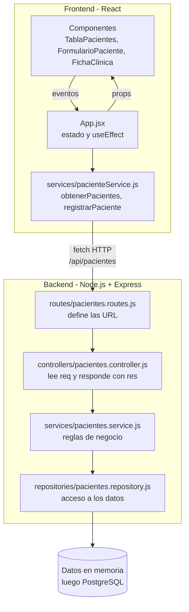

# Sistema de Información: Veterinaria Chiloé

Una aplicación web moderna y responsiva diseñada para gestionar y realizar el seguimiento de los datos de pacientes en clínicas veterinarias. Este proyecto sirve como base educativa para construir interfaces web escalables utilizando el ecosistema moderno de JavaScript, utilizando React.

Este proyecto se enmarca dentro de la asignatura de Tecnologías Web y Móviles de 6to Semestre en Ingeniería Civil en Informática, de la Universidad de Los Lagos.

## 🚀 Stack Tecnológico

* **Frontend:** React + Vite
* **Estilos:** CSS
* **Backend:** Node.js + Express (API REST)
* **Base de Datos (Planificada):** PostgreSQL

## 🧱 Arquitectura en capas

El sistema está separado en N-Capas. Cada capa tiene una sola responsabilidad y solo conversa con la capa vecina.



| Capa | Archivo | Responsabilidad |
|---|---|---|
| Vista | `src/components/` | Solo muestran información, todo les llega por props |
| Servicios (frontend) | `src/services/pacienteService.js` | Pide y envía los datos a la API con `fetch` |
| Rutas | `server/src/routes/` | Define las URL (GET, POST) y a qué controlador van |
| Controladores | `server/src/controllers/` | Traducen HTTP: leen `req` y responden con `res` |
| Servicios (backend) | `server/src/services/` | Reglas de negocio: valida la especie y genera el N° de atención |
| Repositorios | `server/src/repositories/` | Los únicos que tocan los datos |

## 🔌 Endpoints

| Método | Ruta | Respuesta |
|---|---|---|
| GET | `/api/pacientes` | `200` con la lista de pacientes |
| POST | `/api/pacientes` | `201` con el paciente creado |
| POST | `/api/pacientes` con especie no permitida | `400` con el mensaje de error |

## ⚙️ Requisitos Previos

* [Node.js](https://nodejs.org/) (incluye npm) instalado en tu computadora local.

## 🛠️ Instalación y ejecución

1. Clona el repositorio:
   ```bash
   git clone https://github.com/Vikktor93/vetChiloe.git
   cd vetChiloe
   ```

2. Backend (terminal 1):
   ```bash
   cd server
   npm install
   npm run dev
   ```
   Queda funcionando en `http://localhost:3000`.

3. Frontend (terminal 2, desde la carpeta raíz):
   ```bash
   npm install --legacy-peer-deps
   npm run dev
   ```
   Queda funcionando en `http://localhost:5173`.

> El `--legacy-peer-deps` es necesario porque `react-card-flip` todavía pide React 18.