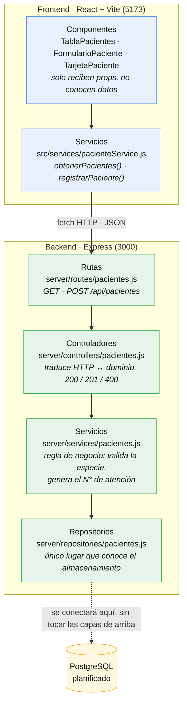

# Sistema de Información: Veterinaria Chiloé 

Una aplicación web moderna y responsiva diseñada para gestionar y realizar el seguimiento de los datos de pacientes en clínicas veterinarias. Este proyecto sirve como base educativa para construir interfaces web escalables utilizando el ecosistema moderno de JavaScript, utilizando React.

Este proyecto se enmarca dentro de la asignatura de Tecnologías Web y Móviles de 6to Semestre en Ingeniería Civil en Informática, de la Universidad de Los Lagos.

## 🚀 Stack Tecnológico

* **Frontend:** React + Vite
* **Estilos:** CSS (App.css)
* **Backend:** Node.js + Express
* **Base de Datos (Planificada):** PostgreSQL

## 🧱 Arquitectura en N-Capas

Cada capa tiene una sola responsabilidad y solo conoce a la que tiene inmediatamente debajo. Una petición atraviesa el sistema así:



### Qué hace cada capa

| Capa | Archivo | Responsabilidad |
| --- | --- | --- |
| Componentes | `src/components/*.jsx` | Mostrar información. Reciben todo por props y no obtienen datos por su cuenta. |
| Servicios (front) | `src/services/pacienteService.js` | Único punto de contacto con la API. Es lo único que cambió al conectar el backend. |
| Rutas | `server/routes/pacientes.js` | Mapea método + URL a un controlador. No tiene lógica. |
| Controladores | `server/controllers/pacientes.js` | Traduce HTTP a dominio: lee `req.body`, responde 200/201 y convierte un error de validación en 400. |
| Servicios (back) | `server/services/pacientes.js` | Regla de negocio: valida que la especie exista en el catálogo compartido con el formulario y genera el N° de atención. |
| Repositorios | `server/repositories/pacientes.js` | Único lugar que sabe dónde viven los datos. Hoy un arreglo en memoria; mañana PostgreSQL. |

## 📁 Estructura del repositorio

```text
vetChiloe/
├── src/                              # Frontend · React + Vite
│   ├── components/                   # Presentación: solo props, sin acceso a datos
│   │   ├── FlipCard.jsx / .css       · animación de giro reutilizable
│   │   ├── TablaPacientes.jsx / .css · listado de pacientes
│   │   ├── FormularioPaciente.jsx / .css · alta con validación
│   │   └── TarjetaPaciente.jsx / .css    · carnet del paciente
│   ├── data/
│   │   └── pacientesMock.js          · semilla de la Parte A (ya no la importa nadie)
│   ├── services/
│   │   └── pacienteService.js        · único punto de contacto con la API
│   ├── utils/
│   │   └── validaciones.js           · reglas del formulario + catálogo ESPECIES
│   ├── assets/                       · imágenes del template de Vite
│   ├── App.jsx                       · composición: carga el listado en useEffect
│   ├── App.css
│   ├── index.css
│   └── main.jsx
│
├── server/                           # Backend · Express en el puerto 3000
│   ├── routes/
│   │   └── pacientes.js              · GET · POST /api/pacientes
│   ├── controllers/
│   │   └── pacientes.js              · traduce HTTP ↔ dominio: 200 / 201 / 400
│   ├── services/
│   │   └── pacientes.js              · regla de negocio + N° de atención
│   ├── repositories/
│   │   └── pacientes.js              · almacenamiento: arreglo en memoria
│   ├── index.js                      · app Express: cors, json, monta las rutas
│   ├── package.json                  · dependencias propias: express, cors
│   └── package-lock.json
│
├── public/
│   ├── pets/                         · fotos de los pacientes (URL plana)
│   ├── favicon.svg
│   └── icons.svg
│
├── index.html
├── vite.config.js
├── eslint.config.js                  · reglas del frontend + bloque Node para server/
├── package.json                      · dependencias del frontend
├── package-lock.json
├── .gitignore
└── README.md
```

Dentro de cada capa hay un archivo `pacientes.js` y nada más: la capa de rutas no importa al repositorio, ni el repositorio importa a los controladores. Cada una solo conoce a la que tiene inmediatamente debajo.

Hay **dos `package.json`**, o sea dos paquetes npm independientes: hay que correr `npm install` en la raíz y otra vez dentro de `server/`.

## ⚙️ Requisitos Previos

* [Node.js](https://nodejs.org/) (incluye npm) instalado en tu computadora local.

## 🛠️ Instalación y Configuración

1. Clona el repositorio:
   ```bash
   git clone https://github.com/Vikktor93/vetChiloe
   cd vetChiloe
   ```

2. Instala las dependencias del frontend:
   ```bash
   npm install
   ```

3. Instala las dependencias del backend:
   ```bash
   cd server
   npm install
   cd ..
   ```

## ▶️ Cómo ejecutar

Hacen falta **dos terminales**, porque el frontend y la API son procesos distintos.

Terminal 1 — la API en http://localhost:3000:

```bash
cd server
npm run dev
```

Terminal 2 — la interfaz en http://localhost:5173:

```bash
npm run dev
```

Si la API no está levantada, la tabla del frontend mostrará un error de carga en vez del listado.

## 🔌 Endpoints

Base: `http://localhost:3000/api/pacientes`

| Método | Ruta | Respuesta |
| --- | --- | --- |
| GET | `/api/pacientes` | `200` — arreglo con todos los pacientes |
| POST | `/api/pacientes` | `201` — el paciente creado, con `id` y `numero_atencion` emitidos por el servidor |
| POST | `/api/pacientes` con una especie fuera del catálogo | `400` — `{ "error": "..." }` |

Ejemplo de alta:

```bash
curl -X POST http://localhost:3000/api/pacientes \
  -H 'Content-Type: application/json' \
  -d '{"nombre":"Rocky","especie":"Canino","peso":9.4,"dueno":"12345678-9","telefono":"+56911112222","edad":4,"ultima_visita":"2026-04-01"}'
```

El `numero_atencion` que envíe el cliente se ignora: lo emite el servidor con el formato `AAAA-NNN` (por ejemplo `2026-004`).

### Especies válidas

El catálogo lo comparten el formulario y la API:

| Archivo | Constante | Rol |
| --- | --- | --- |
| `src/utils/validaciones.js` | `ESPECIES` | Las opciones que ofrece el formulario |
| `server/services/pacientes.js` | `ESPECIES_VALIDAS` | Las que acepta la API |

Las dos listas deben coincidir. Hoy son `Canino`, `Felino`, `Ave`, `Roedor`, `Reptil` y `Otro`.

Como el formulario solo ofrece especies del catálogo, **el `400` por especie inválida no se puede provocar desde la interfaz**: se prueba directo contra la API, con una especie fuera de la lista o sin el campo.

```bash
curl -X POST http://localhost:3000/api/pacientes \
  -H 'Content-Type: application/json' \
  -d '{"nombre":"Test","especie":"Serpiente"}'
# 400 {"error":"La especie debe ser una de: Canino, Felino, Ave, Roedor, Reptil, Otro. Se recibió: Serpiente."}
```
