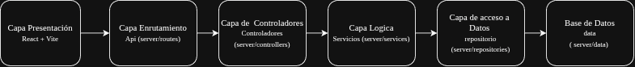

# Sistema de Información: Veterinaria Chiloé 

Una aplicación web moderna y responsiva diseñada para gestionar y realizar el seguimiento de los datos de pacientes en clínicas veterinarias. Este proyecto sirve como base educativa para construir interfaces web escalables utilizando el ecosistema moderno de JavaScript, utilizando React.

Este proyecto se enmarca dentro de la asignatura de Tecnologías Web y Móviles de 6to Semestre en Ingeniería Civil en Informática, de la Universidad de Los Lagos.

## 🚀 Stack Tecnológico

* **Frontend:** React + Vite
* **Estilos:** CSS (App.css)
* **Backend (Planificado):** Node.js + Express
* **Base de Datos (Planificada):** PostgreSQL

## 🧱 Diagrama de capas



| Capa | Responsabilidad | Ubicación |
|---|---|---|
| Presentación | Interfaz de usuario construida con React y Vite. | `src/` |
| Enrutamiento API | Define las rutas HTTP de la API. | `src/server/routes/` |
| Controladores | Recibe las peticiones y coordina las respuestas. | `src/server/controller/` |
| Lógica de servicios | Contiene la lógica de negocio. | `src/server/service/server/` |
| Acceso a datos | Gestiona el acceso al repositorio. | `src/server/repositories/` |
| Base de datos | Contiene los datos de la aplicación. | `src/server/data/` |

## ⚙️ Requisitos Previos

* [Node.js](https://nodejs.org/) (incluye npm) instalado en tu computadora local.

## 🛠️ Instalación y Configuración

1. Clona el repositorio:
   ```bash
   git clone https://github.com/Vikktor93/vetChiloe
