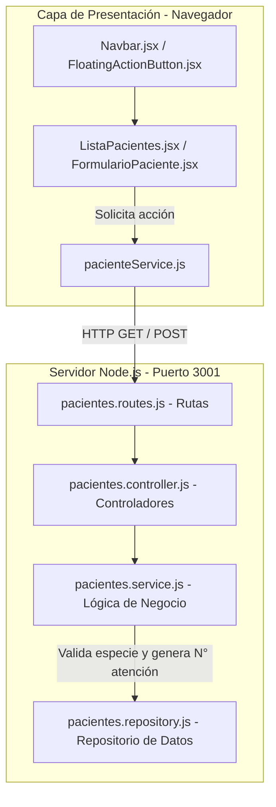

# Mini Proyecto vetChiloé - Arquitectura N-Capas

Este proyecto aplica un modelo de arquitectura N-Capas separando las responsabilidades entre la capa de presentación (React + Vite) y la capa del servidor API REST (Node.js + Express).

## 🛠️ Arquitectura de Capas



## 🚀 Ejecución del Proyecto

1. **Iniciar el Backend (Puerto 3001):**
   ```bash
   cd server
   npm install
   npm run dev
   ```

2. **Iniciar el Frontend (Puerto 5173):**
   ```bash
   npm run dev
   ```